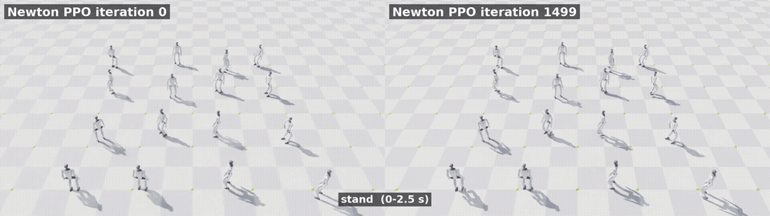

# G1 Locomotion Lab

**A Unitree G1 humanoid learning to walk, and to get back up after a fall, in simulation.**

-8250df)

<!-- END-TO-END DEMO: fall -> get up -> walk (recC), added after rerun -->

16 robots per side, same scripted stand, walk, turn and stop commands. Left: untrained. Right: final walking policy. Fallen robots are reset in place.

## Highlights

- **237 / 256 robots (93%)** stay up through a 24 s stand, walk, turn and stop test with random pushes.
- **Get-up success 50.5% → 68.2%** on held-out lying poses, after diagnosing a joint-limit training collapse.
- **Pushes ≈4× larger than training**: half the robots fall at 2.16 m/s of added speed (M50), vs 0.5 m/s pushes in training.
- **Hand-over strict success ≈2.5% → 28.7%** with an upper-body blend before the switch. <!-- HANDOVER-RECC --> (previous recovery checkpoint; recC rerun pending).

## Walking and getting up

<table>
<tr>
<td width="50%" align="center"></td>
<td width="50%" align="center"></td>
</tr>
<tr>
<td valign="top"><b>Walking.</b> 237 of 256 robots stayed up through a 24 s stand, walk, turn and stop test with random pushes (231 and 233 in reruns). Most falls happen while turning.</td>
<td valign="top"><b>Getting up</b> <i>(work in progress)</i>. From lying on the back, front or side, with no help, in about a second. The current baseline passes strict validity checks on 68% of held-out starting poses.</td>
</tr>
</table>

## From a fold to a stand

Same 16 lying starts, same camera, no assist. Left: an earlier reward settled into a forward fold, pelvis high and torso upside down. Right: a get-up policy standing up.

## What I built

The walking task and PPO are standard Isaac Lab (`Isaac-Velocity-Flat-G1`); the components below are this project's own work. Detail, file by file: [docs/CONTRIBUTIONS.md](docs/CONTRIBUTIONS.md).

| Component | What it does | Path |
|---|---|---|
| Get-up task package | Environment, rewards, observations, pose curriculum and metrics for training a get-up policy | [`recovery/g1_recovery/`](recovery/g1_recovery/) |
| Validity criteria and protocol | Criteria v3 plus the self-penetration check (3b), frozen before evaluation; DEV / HELDOUT / TEST pose sets | [EVAL_PROTOCOL.md](EVAL_PROTOCOL.md) |
| Hand-over controller | Settle, upper-body blend, readiness gate, command ramp: get-up → walking | [`recovery/g1_recovery/fall_handover.py`](recovery/g1_recovery/fall_handover.py) |
| Scripted walking test | Stand, walk, turn, stop with random pushes, across checkpoints | [`walking/scripts/eval_g1.py`](walking/scripts/eval_g1.py) |
| Stress tests | Push, friction and terrain evaluations with Wilson and bootstrap intervals | [`recovery/scripts/`](recovery/scripts/), [pilots](pilots/m4_robustness_20261108/README.md) |

## How it works

Two policies share one interface: the same 123-value observation in, the same 37 joint-position targets out, and the same network shape, so either can drive the robot. The walking policy comes from Isaac Lab's G1 velocity task, trained with rsl_rl PPO on Newton / MuJoCo-Warp at 50 Hz; the get-up policy uses the same setup, starting from lying poses. On a fall, a debounced detector fires, the get-up policy acts until a criteria-based stand gate passes, and control switches one way to walking through the hand-over controller (settle, upper-body blend, command ramp). Evaluation runs on fixed pose sets — DEV to iterate, HELDOUT to compare, TEST untouched — with validity checks frozen before any result was scored.

## Key findings

- **The get-up still straddles.** Every standing policy here pushes its feet about 1.4 m apart, around 0.4 s into the rise (peak foot spread 1.38 m before, 1.39 m after), before settling to a normal stance. Penalties for foot spread and joint effort cut success from about 128 to 64 to 83 of 256 without moving the spread, so a fix likely needs reference motion ([notes](pilots/humanlike_20261108/ROADMAP.md)).
- **Continued training can collapse because of joint limits.** Policies drifted toward joint limits and fell apart, whatever the learning rate or entropy setting tried. A penalty on body joint limits (weight -100) with a learning rate of 3e-5 kept training stable and produced the recC checkpoint ([Goal 4 write-up](pilots/g4_humanlike_getup_20261108/README.md)).
- **Getting up works; handing over is the weak link.** The get-up policy ends with arms, fingers and waist about 1.2 to 1.3 rad away from the pose the walking policy expects, against 0.03 to 0.07 rad of normal variation, and feet 0.44 m apart against 0.24 m. Blending the upper body before the switch and waiting for a readiness check recover most of the loss ([M2](pilots/m2_fall_handover_20261108/README.md), [M2b](pilots/m2b_handover_fixes_20261108/README.md)).
- **Friction in this solver is a maximum, not a product.** Lowering only the floor friction does nothing, since contacts use the larger of the two materials. The first friction sweep was invalid for this reason and was discarded; the fixed one lowers both together.

## Results

| | Result |
|---|---|
| Walking, 24 s pushed test | 237 / 256 robots stay up (reruns 231, 233) |
| Get-up, 256 held-out poses | 68.2% pass all checks, up from 50.5% |
| Hand-over, strict end-to-end | 28.7% with the upper-body blend, up from ≈2.5% |
| Push robustness | half fall at 2.16 m/s added speed (M50), ~4× the training push |
| Friction 0.3 | M50 falls from 2.16 to 1.45 m/s |
| Terrain, blind on flat-trained policy | ≥80% survival to 19° downhill, 9° uphill, 5.8 cm steps down, 2.8 cm up, 8 cm noise |

**These are single-seed results in simulation only.** Seeds, held-out vs TEST notes, per-direction breakdowns, confidence intervals and pilot write-ups: [docs/RESULTS.md](docs/RESULTS.md).

## Reproduce

- `make test` — CPU tests (metrics, hand-over state machine), no Isaac Lab needed. Isaac Lab setup: [docs/SETUP.md](docs/SETUP.md).
- Walking: [train and evaluate](docs/WALKING.md#reproducing). Get-up: [recovery](recovery/README.md). Each pilot ([M2](pilots/m2_fall_handover_20261108/README.md), [M2b](pilots/m2b_handover_fixes_20261108/README.md), [M3](pilots/m3_terrain_baseline_20261108/README.md), [M4](pilots/m4_robustness_20261108/README.md), [G4](pilots/g4_humanlike_getup_20261108/README.md)) ends with its own Reproduce section.

## Explore

| | |
|---|---|
| **Walking write-up** | [Results](docs/WALKING.md#results-at-a-glance) · [method](docs/WALKING.md#method-and-architecture) · [reproduce](docs/WALKING.md#reproducing) · [limitations](docs/WALKING.md#limitations) |
| **Getting up** | [Video gallery](recovery/README.md) · [system overview](recovery/architecture/SYSTEM_OVERVIEW.md) · [network diagram](recovery/architecture/figures/network_architecture_dark.png) · [checkpoints](recovery/checkpoints/README.md) |
| **Status, data, checks** | [Roadmap](pilots/humanlike_20261108/ROADMAP.md) · [status](STATUS.md) · [experiment log](EXPERIMENT_LOG.md) · [walking results](walking/results/) · [GPU physics check](walking/diagnostics/README.md) |

## Repository layout

| Path | Contents |
|---|---|
| `walking/` | The walking project as first published: configs, scripts, results, media, diagnostics, licences |
| `recovery/` | Get-up project: task package `g1_recovery/`, scripts, tests, criteria, media, architecture diagrams ([README](recovery/README.md)) |
| `pilots/` | Dated, bounded experiments, each with its own README: [humanlike](pilots/humanlike_20261108/ROADMAP.md) (negative reward-only pilot and the roadmap), [m2](pilots/m2_fall_handover_20261108/README.md) / [m2b](pilots/m2b_handover_fixes_20261108/README.md) (hand-over), [m3](pilots/m3_terrain_baseline_20261108/README.md) (terrain), [m4](pilots/m4_robustness_20261108/README.md) (pushes, friction), [g4](pilots/g4_humanlike_getup_20261108/README.md) (get-up training, recC) |
| `docs/` | [Walking write-up](docs/WALKING.md), [contributions](docs/CONTRIBUTIONS.md), [results](docs/RESULTS.md), [setup](docs/SETUP.md) |
| `archive/` | Historical experiment outputs: result JSON, run logs and videos from earlier runs |
| `EVAL_PROTOCOL.md`, `EXPERIMENT_LOG.md`, `STATUS.md`, `PROVENANCE.md` | Evaluation protocol (criteria v3), dated experiment log, current status, provenance of imported parts |

## Limitations and next steps

- **The get-up still straddles** (feet ≈1.4 m apart mid-rise); reward-side fixes did not remove it, and a human-like get-up likely needs reference motion.
- **Upward steps fail from 4.3 cm**: all 24 robots fell there, though the policy was trained on flat ground and sees no height scan.
- **One training seed** everywhere; evaluation is not bit-repeatable (walking-test reruns gave 231–237 of 256).
- **Simulation only**: no physical robot, no sim-to-real work.

Next: more seeds, the recC end-to-end rerun, terrain-aware walking.

## Credits and licenses

Built on [Isaac Lab](https://github.com/isaac-sim/IsaacLab) by the Isaac Lab Project Developers (NVIDIA and
contributors), the Unitree G1 robot by Unitree Robotics, [rsl_rl](https://github.com/leggedrobotics/rsl_rl)
(ETH Zurich / NVIDIA), [Newton](https://github.com/newton-physics/newton),
[MuJoCo-Warp](https://github.com/google-deepmind/mujoco_warp) and NVIDIA Warp. PPO: Schulman et al., 2017.
Licenses: [LICENSE](walking/LICENSE) covers only my original material (BSD-3-Clause, Copyright (c) 2026 Kaleb Coleman).
Third-party code, models and tools keep their own licenses: see [NOTICE.md](walking/NOTICE.md) and the full texts in
[`THIRD_PARTY_LICENSES/`](walking/THIRD_PARTY_LICENSES/). Not affiliated with or endorsed by NVIDIA or Unitree.