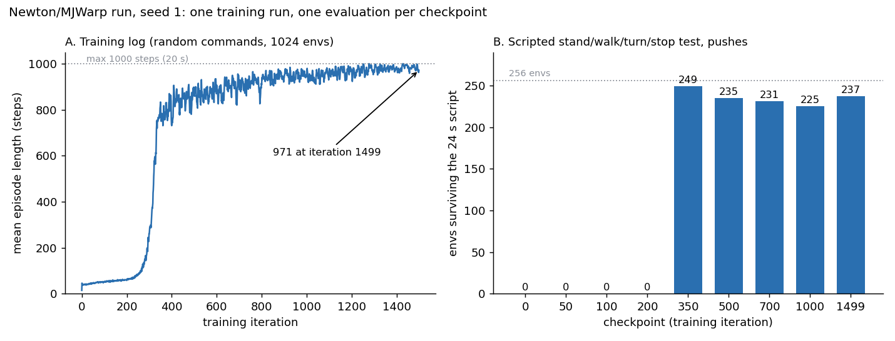
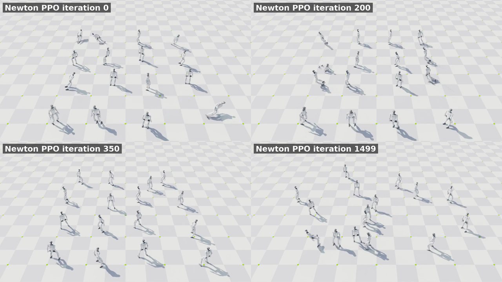
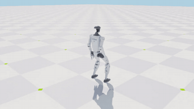
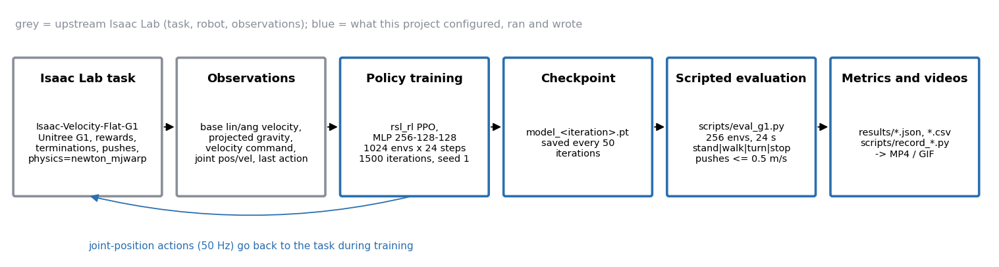

# G1 Locomotion Lab

**A simulation research demo for training and evaluating Unitree G1 locomotion in Isaac Lab, with Newton/MJWarp.**
It uses Isaac Lab's existing G1 velocity task and PPO setup; simulation only, no physical robot.


*16 simulated Unitree G1 robots per side, same scripted commands: stand, walk, turn, stop. Left: the untrained
policy (iteration 0). Right: the final policy (iteration 1499). Robots that fall are reset in place and keep
going, see [How to read the clips](#how-to-read-the-clips).*

**Jump to:** [Results](#results-at-a-glance) · [Method](#method-and-architecture) · [Reproducing](#reproducing) · [Limitations](#limitations) · [Credits](#credits) · [GPU-physics check](diagnostics/README.md)

## Summary

I took NVIDIA Isaac Lab's existing Unitree G1 velocity-tracking task (`Isaac-Velocity-Flat-G1`) and its
existing PPO setup (rsl_rl), and trained a simulated walking policy with Isaac Lab's **Newton / MuJoCo-Warp**
physics backend. I then wrote a scripted evaluation (stand, walk, turn, stop, with random pushes), ran it across
checkpoints, recorded videos, and documented what worked and what did not.

**Simulation only.** Nothing here was run on a physical robot.

What is mine and what is not:

| Upstream (not mine) | This project |
|---|---|
| Isaac Lab, the G1 task, rewards, observations, terminations, PPO hyperparameters | Choosing Newton physics, 1,024 envs, 1,500 iterations, seed 1, and running the training |
| The Unitree G1 robot model | `scripts/eval_g1.py`: scripted stand/walk/turn/stop test with pushes |
| The PPO algorithm (Schulman et al.) and rsl_rl implementation | Checkpoint-ladder evaluation, recording scripts, figures, write-up |
| Newton, MuJoCo-Warp, Warp, Isaac Sim | |

I did not change the task, rewards or hyperparameters. The only settings I chose are the physics backend,
environment count, seed and (default) iteration count. See [NOTICE.md](NOTICE.md) for attribution.

## Results at a glance

**Two different kinds of number appear below. Do not mix them up.** (A) is a *training-log* metric from the 1,024
training environments. (B) is a *separate scripted test* of saved checkpoints in 256 fresh environments. Everything is one
seed (seed 1) and one run; there are no repeats or confidence intervals.



**A (left): the training log.** Mean episode length at the end of training was **971 of a possible 1,000
steps** (20 s at 50 Hz). This is the value of `Train/mean_episode_length` at iteration 1499 from the run's
TensorBoard log ([`results/training_curves.csv`](results/training_curves.csv),
[final log block](results/training_final_iteration.log)), averaged over episodes that ended in that iteration across the 1,024
training environments. Those environments use random velocity commands and random pushes. It is a single
unsmoothed value (iteration 1498 was 962); about 96.7% of episode ends were time-outs and 3.3% were falls
(torso contact). It describes training behaviour, not the scripted test.

**B (right): the scripted test** below, one run per checkpoint, 256 environments each.

### The scripted evaluation

`scripts/eval_g1.py` runs 256 parallel environments for **24 s (1,200 steps at 50 Hz)** through four 6-second
phases with fixed commands: **stand** (0, 0, 0), **walk** forward 0.8 m/s, **turn** in place 0.8 rad/s, **stop**.
Random velocity pushes of up to **0.5 m/s** in x and y hit each robot every 2.5 s (the task's own `push_robot`
event, with a shorter interval than in training, which pushes every 10-15 s). Seed 1, **one run per row**: no
repeats, no confidence intervals. "Survivors" are environments that never fell (torso contact) in the 24 s.
Tracking errors are averaged over survivors in the phase (walk: linear-velocity error in m/s; turn: yaw-rate error in rad/s).

| Newton policy checkpoint | Survivors | Falls stand / walk / turn / stop | Walk lin. err (m/s) | Turn yaw err (rad/s) |
|---|---|---|---|---|
| iteration 0 | 0/256 | 256 / 0 / 0 / 0 | n/a | n/a |
| iteration 50 | 0/256 | 256 / 0 / 0 / 0 | n/a | n/a |
| iteration 100 | 0/256 | 256 / 0 / 0 / 0 | n/a | n/a |
| iteration 200 | 0/256 | 256 / 0 / 0 / 0 | n/a | n/a |
| iteration 350 | 249/256 | 5 / 0 / 1 / 1 | 0.68 | 0.92 |
| iteration 500 | 235/256 | 18 / 1 / 1 / 1 | 0.43 | 0.87 |
| iteration 700 | 231/256 | 6 / 4 / 7 / 8 | 0.15 | 0.71 |
| iteration 1000 | 225/256 | 5 / 6 / 7 / 13 | 0.10 | 0.77 |
| **iteration 1499 (final)** | **237/256** | 0 / 2 / **17** / 0 | 0.11 | 0.38 |

Raw per-run JSON is in [`results/`](results/), summary in [`results/eval_summary.csv`](results/eval_summary.csv).

What the numbers do and do not say:

- Between iterations 200 and 350 the policy goes from every robot falling in the stand phase to almost all
  staying up. Iteration 350 survives most often (249) but barely tracks the walk command (0.68 m/s error on a
  0.8 m/s command). By iteration 1499 tracking is much better at 237/256. Survival is not monotonic over
  iterations, and differences of a few percent are within what one seed cannot resolve.
- **Most remaining falls happen while turning:** 17 of the 19 falls of the final Newton policy are in the turn
  phase. The turn yaw error (0.38 rad/s for a 0.8 rad/s command) is also the largest tracking error.
- **This is one training run and one evaluation per checkpoint** (seed 1). It shows how this policy behaved in
  this test; it is not a general claim about Newton, MuJoCo-Warp or PPO.
- **Iteration 1499 is the policy I show** because it tracks the commands best, not because it survived the most
  environments (iteration 350 did).
- I recorded wall-clock throughput during evaluation, but the GPU was shared with other jobs, so it is **not a
  benchmark** and is not reported here (the raw JSONs carry a note saying the same).

### Learning progression



Same frame (t = 6 s, during the turn phase) from the 16-robot clips at iterations 0, 200, 350 and 1499. In the
clips, terminations among the 16 robots over 10 s were 119 (iteration 0), 106 (200), 0 (350) and 1 (1499).

### How to read the clips

- **Environments reset after a fall.** In every clip, a robot that falls (torso contact) is reset by the
  environment to its starting pose and keeps running. The recording scripts disable the time limit only; falls
  still terminate and reset the environment. The termination counts above (which can exceed 16 because a robot can fall again
  after resetting) come from `done` flags during recording. A robot that appears upright at iteration 0 may just
  have been reset.
- The progression clips use 16 robots in a fixed-camera view, no pushes. The single-robot clips use a camera that
  follows the robot, so the floor moves instead of the robot, and also have no pushes.
- The 24-second pushed evaluation is separate from the clips and is only reported as numbers.
- Stand-up after a fall is **not implemented**: a fallen robot is simply reset.

**Final policy (iteration 1499), one robot, 8 s** (stand 2 s, walk 2 s, turn 2 s, stop 2 s; no pushes, no falls in this clip):



## Method and architecture



Checked against the code (Isaac Lab 3.0.0 `velocity_env_cfg.py`, `g1/flat_env_cfg.py`, `g1/agents/rsl_rl_ppo_cfg.py`):

- **Task:** `Isaac-Velocity-Flat-G1`, flat terrain, command ranges x in [0, 1] m/s, y in [-0.5, 0.5] m/s, yaw
  rate in [-1, 1] rad/s. Policy step 50 Hz (physics dt 0.005 s, decimation 4), 20 s episodes.
- **Observations (no height scan on flat terrain):** base linear and angular velocity, projected gravity,
  velocity command, joint positions and velocities (relative), previous action, with noise as configured in the task.
- **Actions:** joint-position targets for all joints (scale 0.5 around the default pose).
- **Termination:** time-out, or contact of `torso_link` with the ground. A termination is counted as a "fall".
- **Policy:** MLP actor and critic, hidden sizes 256-128-128, ELU, PPO (rsl_rl `OnPolicyRunner`), 24 steps per env
  per iteration, learning rate 1e-3 adaptive, gamma 0.99, lambda 0.95. Full resolved configs:
  [`configs/rsl_rl_agent.yaml`](configs/rsl_rl_agent.yaml), [`configs/isaaclab_env.yaml`](configs/isaaclab_env.yaml).
- **Physics:** `physics=newton_mjwarp` (Newton with the MuJoCo-Warp solver). The task's flat config already
  defaults to this in Isaac Lab 3.0.0.
- **Training run:** 1,024 envs x 24 steps x 1,500 iterations = 36,864,000 environment steps, seed 1, about 40 minutes
  wall time (2,375 s) with the Isaac Sim viewer open on a GPU shared with other jobs.
- **Evaluation:** `scripts/eval_g1.py` takes the training environment config (`--train_env_cfg`, so the task's
  training-time randomization stays on), overrides the velocity command per phase, and re-enables the push event
  at 0.5 m/s every 2.5 s.

## Reproducing

**Software (as run):** Ubuntu 22.04, Python 3.12, Isaac Lab 3.0.0, Isaac Sim 6.2.0, Newton 1.6.1,
MuJoCo-Warp 3.12.0, MuJoCo 3.12.0, Warp 1.17.0, rsl-rl-lib 5.5.1, PyTorch 2.11.0+cu130, NumPy 2.5.4,
NVIDIA driver 595.99.02 (CUDA 13.2). **Hardware:** Intel Xeon w5-3435X, 125 GB RAM, one NVIDIA RTX PRO 6000
Blackwell Max-Q Workstation Edition (98 GB), shared with other jobs. Training is not bit-for-bit repeatable (the
Isaac Lab config sets `deterministic_mode: not_guaranteed`), so expect similar, not identical, numbers.

Set up Isaac Lab 3.0.0 by following its [installation guide](https://isaac-sim.github.io/IsaacLab/), then
(`export OMNI_KIT_ACCEPT_EULA=YES`, run from the Isaac Lab checkout):

```bash
# 1. Train (this is the exact command that was run; --viz kit opens the viewer, drop it for a headless run)
python scripts/reinforcement_learning/train.py --task Isaac-Velocity-Flat-G1 \
    --num_envs 1024 --max_iterations 1500 --seed 1 --viz kit physics=newton_mjwarp

# 2. Evaluate a checkpoint (what produced the table; Lab 3 is headless by default, no --headless flag)
python /path/to/g1-locomotion-lab/scripts/eval_g1.py --task Isaac-Velocity-Flat-G1 \
    --checkpoint logs/rsl_rl/g1_flat/<run>/model_1499.pt --num_envs 256 --train_env_cfg \
    --push_vel 0.5 --push_interval 2.5 --out result.json physics=newton_mjwarp

# 3. Or the whole ladder (output goes to results/raw/)
ISAACLAB_SRC=/path/to/IsaacLab ISAACLAB_PY=python scripts/eval_ladder.sh logs/rsl_rl/g1_flat/<run> \
    newton_mjwarp 0 50 100 200 350 500 700 1000 1499
```

Notes: video capture needs `enable_cameras` and a Kit visualizer configuration, handled in `scripts/record_g1.py` and `scripts/record_prog.py`
(wrappers, unverified: `scripts/record_angles.sh`, `scripts/record_progression.sh`;
`scripts/make_public_media.sh` and `scripts/make_figures.py` build everything in `media/`).
The shell wrappers were rewritten (no absolute paths) and are unverified; the arguments they pass
are the ones originally used (`--num_envs 16 --train_env_cfg` for the progression clips, `--num_envs 1 --train_env_cfg`
for the single-robot clip), and the Python scripts they call are the originals.

**What has been verified.** `scripts/eval_g1.py`, `scripts/record_g1.py` and `scripts/record_prog.py` are the scripts that
produced the published numbers and clips. **Unverified:** the shell wrappers `scripts/eval_ladder.sh`,
`scripts/record_angles.sh` and `scripts/record_progression.sh` were rewritten for this repository and have **not** been
smoke-tested; `scripts/make_public_media.sh` and `scripts/make_figures.py` were run and produced the files in `media/`.

**Checkpoints:** not included in this repository. Retrain with command 1 (about 40 minutes on the hardware above).
**Not redistributable here (see NOTICE.md):** the Unitree G1 USD model and other NVIDIA assets (Isaac Lab fetches them at run
time), Isaac Sim, and the raw MP4s (the public GIFs and PNGs in `media/` are derived from them).

## GPU-physics check (separate diagnostic)

A separate 16-environment diagnostic confirmed that the task's Newton/MuJoCo-Warp solver and its state arrays live on the
GPU and that CUDA-graph launches contain Newton collision and MuJoCo-Warp solver kernels. It was a separate short process
on a shared GPU; the original 1,024-environment training run was not traced, and no speed comparison is made.
Details and caveats: [`diagnostics/README.md`](diagnostics/README.md).

## Limitations

- Simulation only; no new locomotion algorithm, task or robot model, and no physical robot deployment; no sim-to-real work and no claim about a physical G1.
- One seed, one training run per backend, one evaluation per checkpoint. No confidence intervals.
- Flat terrain only. The evaluation is a single scripted 24 s sequence with one push magnitude.
- Turning is the main weakness of the final policy. Stand-up from a fall is not implemented.
- I chose the final checkpoint for the videos because it tracks commands best, not because it had the most survivors (iteration 350 did).
- Only the Newton/MuJoCo-Warp backend was used for the results here; no cross-backend comparison is made.

## What someone could build on next

- Improve turning robustness (command curriculum for yaw, targeted pushes while turning, reward changes), with
  several seeds and confidence intervals.
- Add recovery from falls (stand-up) as a separate task or curriculum.
- A controlled backend comparison: same seed, same iteration budget, same GPU load, idle machine for timing.
- Train on rough terrain and test larger pushes.

## Repository layout

```
README.md  LICENSE  NOTICE.md  THIRD_PARTY_LICENSES/ (upstream license texts)
scripts/   eval_g1.py eval_ladder.sh record_g1.py record_prog.py record_angles.sh record_progression.sh
           export_training_curves.py make_public_media.sh make_figures.py
diagnostics/ GPU-physics check (script, trace summary, graph dump)
results/   eval_summary.csv, 9 per-run JSON files, training_curves.csv, training_final_iteration.log
configs/   resolved Isaac Lab / rsl_rl configuration of the training run
media/     hero GIF, chart, architecture diagram, frame montage, one single-robot GIF
```

## Credits and licenses

Built on [Isaac Lab](https://github.com/isaac-sim/IsaacLab) by the Isaac Lab Project Developers (NVIDIA and
contributors), the Unitree G1 robot by Unitree Robotics, [rsl_rl](https://github.com/leggedrobotics/rsl_rl)
(ETH Zurich / NVIDIA), [Newton](https://github.com/newton-physics/newton),
[MuJoCo-Warp](https://github.com/google-deepmind/mujoco_warp) and NVIDIA Warp. PPO: Schulman et al., 2017.
Licenses: [LICENSE](LICENSE) covers only my original material (BSD-3-Clause, Copyright (c) 2026 Kaleb Coleman).
Third-party code, models and tools keep their own licenses: see [NOTICE.md](NOTICE.md) and the full texts in
[`THIRD_PARTY_LICENSES/`](THIRD_PARTY_LICENSES/). Not affiliated with or endorsed by NVIDIA or Unitree.
