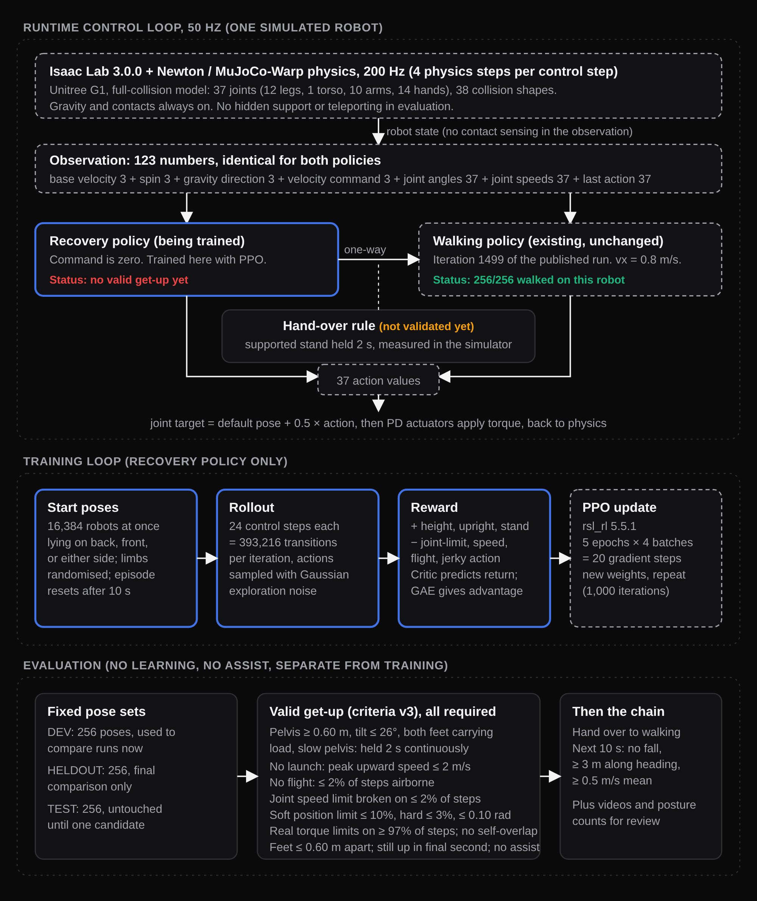
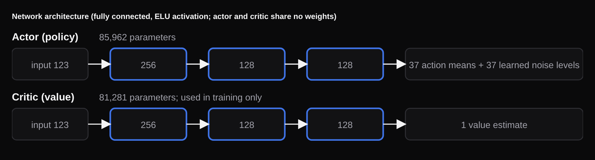

# G1 Locomotion Lab: system overview

Written 2026-11-06 for discussing the project with Dr. Zhang. Simulation only (Isaac Lab 3.0.0, Newton/MuJoCo-Warp, Unitree G1). For live job state and the latest results, see `../STATUS.md` and `../EXPERIMENT_LOG.md`.

**Current result:** walking is verified, recovery is not solved. No policy has produced a valid unassisted get-up under criteria v2.1 or v3. The closest behaviour is a stable wide straddle (`../EXPERIMENT_LOG.md`).

## Short version

> We use two policies with identical inputs and outputs: an existing walking policy and a recovery policy we're training with PPO from lying poses. The recovery policy has to hold a supported stand for 2 s, then one-way control passes to walking. We count success only with assist off and with limits on launching, flight, joint speed and joint position, because PPO repeatedly found ways to score without really standing up. Walking is verified at 256/256 on the full-collision robot. Recovery isn't solved: the current best behaviour is a forward fold, and we're testing whether changing the reward signal gets it out of that pose.

## System

Editable source: `recovery_system_diagram.html`.

## Networks

Editable source: `network_architecture_diagram.html`.

- **Actor:** 123 → 256 → 128 → 128 → 37, ELU activations, 85,962 parameters. Outputs 37 action means plus 37 state-independent noise levels, one per joint.
- **Critic:** same hidden layers, one output, 81,281 parameters. No shared weights; used in training only.
- **Inputs:** both networks get the same 123 values. These don't include contact sensing, so the policy has to infer ground contact from body motion.
- **Actions:** joint target = default pose + 0.5 × action, unclipped, sent to implicit PD actuators at 50 Hz. Physics runs at 200 Hz.
- **Evaluation:** uses the action mean with no noise.

This is the same network shape as Isaac Lab's G1 flat task and the walking policy, which keeps the two policies interchangeable at the hand-over.

## PPO implementation

Standard PPO (Schulman et al., 2017) with GAE (Schulman et al., 2015), using `rsl_rl` 5.5.1 (`OnPolicyRunner` and `PPO`). Values come from the saved run configuration and the library source.

| Setting | Value |
|---|---|
| Data per iteration | 16,384 robots × 24 steps = 393,216 transitions |
| Updates per iteration | 5 epochs × 4 minibatches = 20 Adam steps (minibatch 98,304) |
| Learning rate | 3e-4, fixed |
| Advantage estimation | GAE with γ = 0.99, λ = 0.95, normalised over the whole batch |
| Loss | surrogate (clip 0.2) + 1.0 × clipped value loss − 0.008 × entropy |
| Gradient clipping | Max norm 1.0, applied separately to actor and critic |
| Episode | 10 s, time-out only, random initial episode length |
| Checkpoints | Every 50 iterations |
| Not used | Observation normalisation, symmetry augmentation, curiosity bonus (RND), observation history |

**In plain terms:** the robots try actions with random noise, and the critic predicts how much future reward to expect. GAE measures how much better or worse each action did than predicted. PPO then shifts the policy toward the better actions, and the clip limits how far one update can move it.

The walking policy used the same architecture with an adaptive 1e-3 learning rate, 1,024 robots and 1,500 iterations (seed 1).

## Version names

Two separate numbering schemes both use "v". Say which one you mean.

| Name | What it means |
|---|---|
| Criteria v1, v1.1, v2, v2.1, v3 | The rules for counting a success. v3 (v2.1 + Amendment 3) is current (`../EVAL_PROTOCOL.md`). |
| Training rounds v1–v15 | Batches of experiments, in order. Rounds 1–12 are in `recovery/`; v13–v15 use the R recipes. |
| Lane A / Lane B | Early approaches: A is task reward, B is HoST-inspired assist force with staged rewards. |
| A1…A9, B1…B6, V10–V12 | Runs from rounds 1–12. |
| R1–R7 | Reward and training recipes from rounds 13–15; each usually adds one change. |

**Suffixes**
- **Recipe variants:** `n` no assist, `b`/`c` variants, `u` upright reward, `h` IMU height, `m` multiplicative gate.
- **Starting point:** `S` or "scratch" means random initial weights; "warm" means starting from an earlier checkpoint.

**Recipe lineage**

| Recipe | Change |
|---|---|
| R1 | V11 recipe at 16,384 robots |
| R2 | R1 + body joint position-limit penalty |
| R3 | R2 + assist decays only after a supported stand of at least 1 s |
| R4 | R3 + lying-dominant start poses |
| R4n | R4 with no assist |
| R5 | R4 + action scale 1.0, exploration noise × 2 |
| R6b | R4n + height reward weight 10, upright weight 2 |
| R6c | R6b + lying-only starts |
| R7u, R7h, R7m | R6c + one reward change (below) |

## v15 experiments

All five jobs use 16,384 robots, seed 3, a 3e-4 learning rate and no assist. Iterations are a snapshot from about 23:17 MST on 2026-11-06.

| Job | Iteration | What it changes | Control |
|---|---|---|---|
| R6c (`20261106-215641`) | 661/1000 | Nothing further; it is the baseline | It is the control, and also shows whether more training alone gets out of the fold |
| R7u (`20261106-225219`) | 209/1000 | Upright reward = (1 + up)/2, so it still gives a signal when the torso points downward | R6c |
| R7h (`20261106-225220`) | 207/1000 | Height reward measured at `imu_link` (0.1 → 0.85 m), not the pelvis | R6c |
| R7m (`20261106-225222`) | 207/1000 | Pelvis height reward × (0.25 + 0.75 × upright) | R6c |
| R7u warm (`20261106-225224`) | 557/1350 (207 new) | R7u reward, starting from R6c's fold at iteration 350 | R7u from scratch for the warm-start effect; R6c for the reward effect |

**Why R7 exists:** R6c learned to raise its pelvis to about 0.52 m by folding forward with its torso pointing almost straight down (up = −0.97). Its upright reward is clipped at zero below horizontal, so nothing rewards the robot for rotating out of that pose.

**Comparing runs:** logged reward numbers can't be compared across runs, because each run defines its terms differently. Comparisons use the shared DEV evaluation with assist off.

### R7u reward weights

From the run's saved `env.yaml`. The reward manager scales each term by the time step.

| Term | Weight |
|---|---|
| `height_ramp_floor` | +10 |
| `standing_bonus` | +5 |
| `upright_full` | +2 |
| `default_pose_when_upright` | +1 |
| `pelvis_speed_excess` | −5 |
| `free_flight` | −5 |
| `joint_vel_limits` (soft ratio 0.9) | −10 |
| `joint_pos_limits` (body joints only) | −10 |
| `action_rate_l2` | −0.01 |
| `joint_torques_l2` | −5e-7 |
| `joint_acc_l2` | −2.5e-7 |

## Limitations

- **Seeds:** these are single-seed comparisons, and evaluation isn't bit-repeatable.
- **Earlier results:** A8c's 256/256 is an invalid launch exploit, the 4/256 chain is retracted, and the 2/256 fails v2.
- **Joint limits:** at iteration 300, R6c's fold was past its soft joint limits on 40% of steps and past its hard limits on 3.3%, above the v2.1 limit of 3%.
- **Hand-over:** the rule is implemented but not validated under v3, because no valid stand exists to hand over from.
- **Pose sets:** HELDOUT is saved for the final comparison and TEST is untouched.
- **Scope:** simulation only, with no physical-robot or novelty claims.

## Sources

- Schulman et al., "Proximal Policy Optimization Algorithms", 2017, arXiv:1707.06347.
- Schulman et al., "High-Dimensional Continuous Control Using Generalized Advantage Estimation", 2015, arXiv:1506.02438.
- HoST: Huang et al., RSS 2025, arXiv:2502.08378, MIT licence, https://github.com/InternRobotics/HoST. Ideas adapted with attribution; code not copied.
- HumanUP: He, Dong et al., RSS 2025, arXiv:2502.12152, Apache-2.0, https://github.com/RunpeiDong/HumanUP. Ideas adapted with attribution; code not copied.
- Comparison notes: `../recovery/research/host_humanup_vs_ours.md`.
